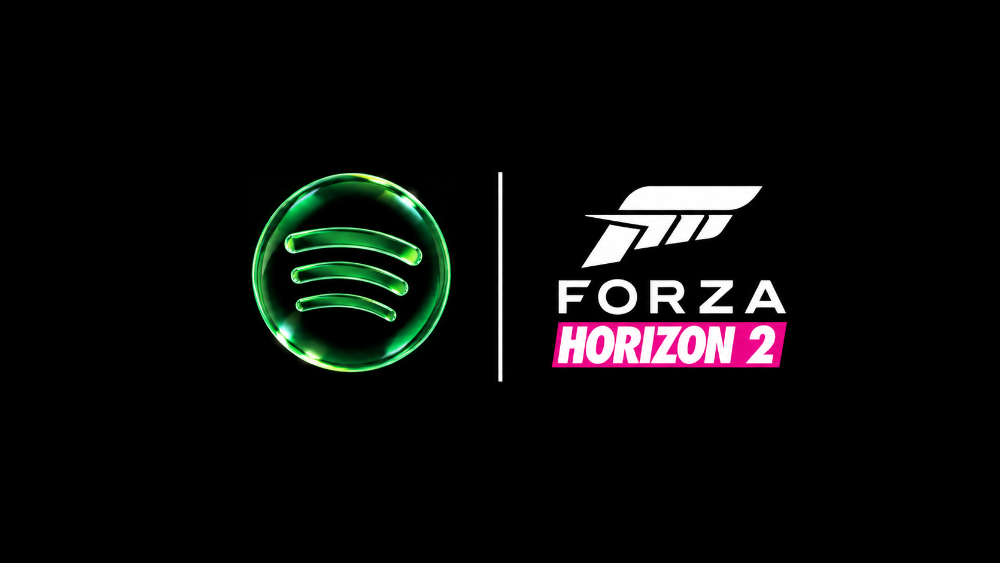

# FH2 Streaming Radio

A mod for **Forza Horizon 2 (Azimuth builds)** that turns the in-game **Innovative Leisure** radio station into a Spotify Connect speaker. Pick "Forza Horizon 2" from the Spotify devices list on your phone, and whatever you play comes out of that station in-game.

Requires Spotify Premium, since Spotify only allows Connect speakers on Premium. Not affiliated with Spotify or Microsoft.

## Install

1. Download the latest zip from [Releases](../../releases).
2. Copy `D3DCompiler_47.dll` and the `spotify-radio` folder into the folder that already has `Azimuth.exe`.
3. Launch the game. When Windows asks, allow `Azimuth.exe` to use **Private networks**. In fullscreen, that prompt can hide behind the game, so Alt+Tab to it.
4. On a phone or other device on the same network, open Spotify, tap the devices icon, and pick **Forza Horizon 2**. Then play something.
5. **IMPORTANT:** Go into the in-game **Audio settings** and turn **OFF Radio DJ**.
6. In-game, switch the radio to **Innovative Leisure**.

After the first time, your login is saved and the game shows up in Spotify automatically whenever it's running.

## Settings

Edit `spotify-radio\config.ini` while the game is closed. You can change the device name, icon, bitrate, starting volume, which station gets taken over, and more. `boost_db` (0 to 12, default 5) raises the station's overall volume.

## Troubleshooting

- Check `spotify-radio\spotify-radio.log`.
- Set `test_tone = true` in `config.ini` to hear a beep on the station instead of Spotify, which tests the game side by itself.
- If your phone doesn't see the device, make sure it's on the same Wi-Fi and the network permission was allowed.
- To forget your Spotify login, delete `spotify-radio\cache`.

## Uninstall

Delete `D3DCompiler_47.dll` and the `spotify-radio` folder, or set `enabled = false` in `config.ini`.

## Credits

Built with [librespot](https://github.com/librespot-org/librespot) (MIT). See `THIRD-PARTY-LICENSES.txt`.
